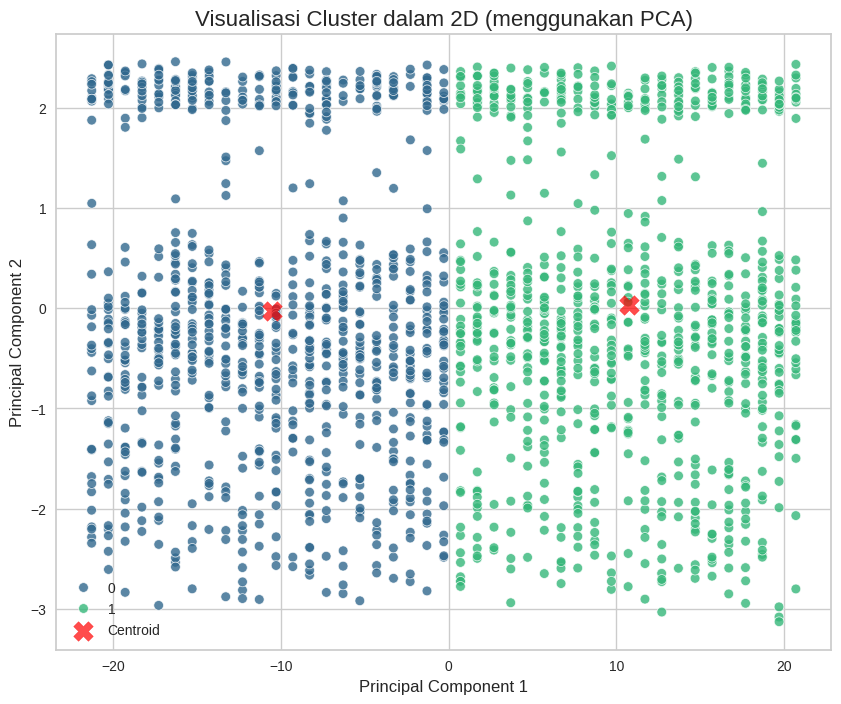
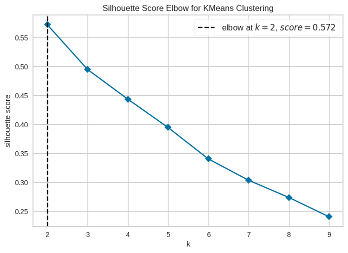
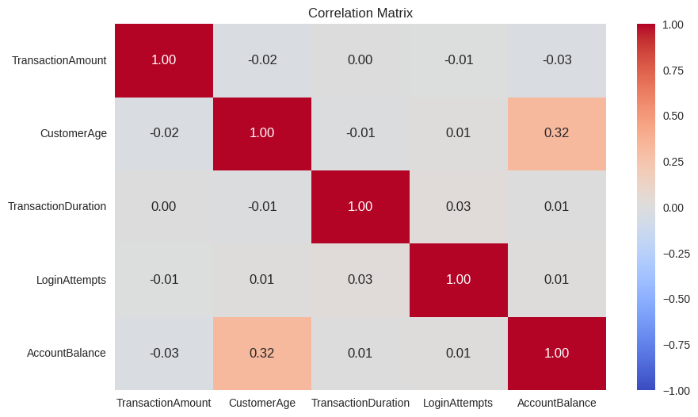
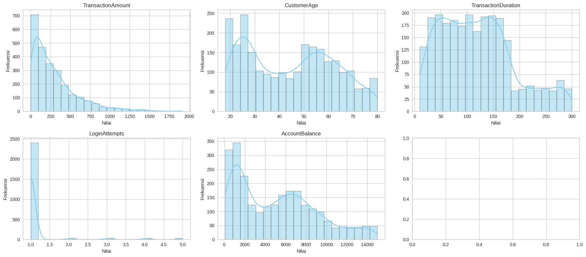
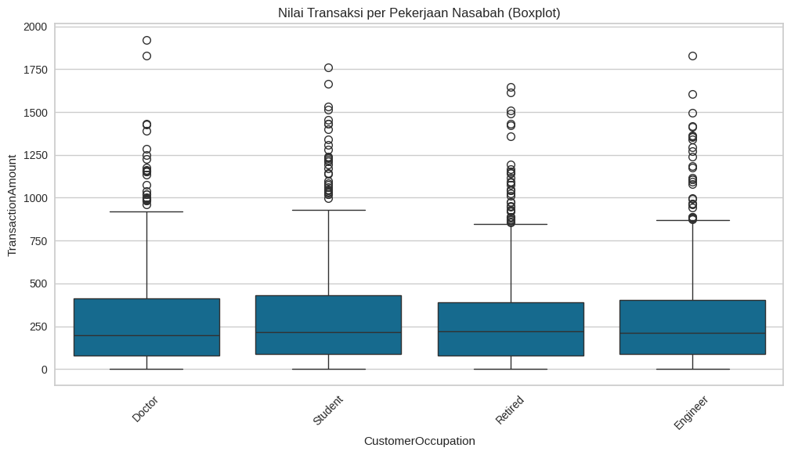

# Fraud Detection Clustering

Unsupervised customer transaction segmentation using K-Means clustering and PCA visualization.

---

## Overview

This repository provides an unsupervised machine learning study on customer financial transactions. It uses K-Means clustering to discover natural behavioral groupings without relying on predefined labels, and applies Principal Component Analysis (PCA) to map high-dimensional transactions into interpretable visual spaces.

Downstream supervised models trained on these cluster partitions are documented in [fraud-detection-classification](../fraud-detection-classification).

---

## Clustering Results

The optimal number of clusters was evaluated using the Elbow Method and Silhouette Analysis:

| Metric | Result |
| :--- | :--- |
| Optimal Cluster Count (k) | 2 |
| Silhouette Score | 0.572 |
| Dimensionality Reduction | PCA (2 components) |

### Cluster Visualization (PCA)

### Silhouette Score Analysis

---

## Exploratory Data Analysis

Key exploratory patterns observed during feature analysis:

### Feature Correlation Heatmap

### Feature Distributions

### Transaction Distribution by Customer Occupation

---

## Related Repositories

- **fraud-detection-clustering** (this repository): Unsupervised customer segmentation via K-Means.
- [fraud-detection-classification](../fraud-detection-classification): Supervised classification using Decision Tree and Random Forest on cluster labels.

---

## License

MIT: [LICENSE](LICENSE)
